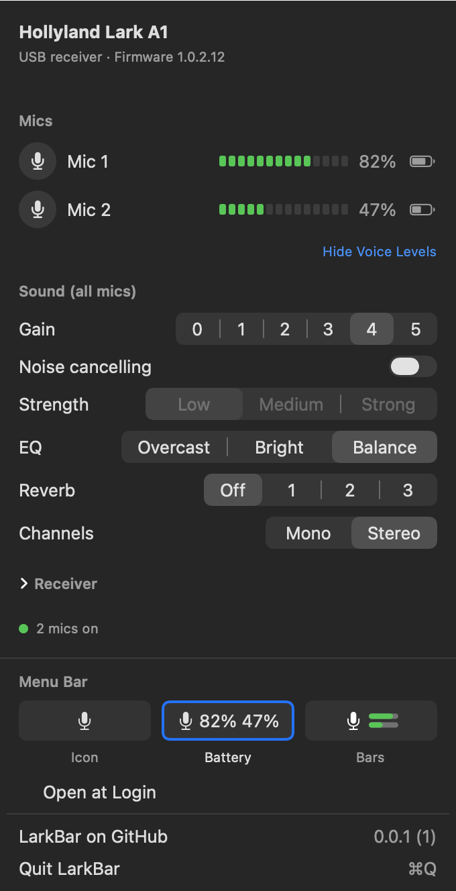

# LarkBar

A small macOS menu bar app for **Hollyland Lark** wireless mics. Plug the Lark USB receiver into your
Mac and LarkBar shows each mic's battery and voice level, and lets you change the receiver's
settings without your phone or the LarkSound app.



- Detects which Hollyland receiver is plugged in, and notices when you plug it in or pull it out.
- Battery level and on/off state for every mic.
- Live voice level bars, so you can see each mic picking you up (optional, see below).
- A mute button for each mic.
- Gain, noise cancelling, EQ, reverb, and mono/stereo. These are receiver settings shared by
  all mics; the Lark doesn't support different sound settings per mic.
- Receiver settings: auto power off, signal mode, status light, performance mode, identify, restart.
- Only shows the controls your receiver supports.
- Menu bar only: no Dock icon, no windows. Choose what the menu bar shows: just the icon, each
  mic's battery percentage, or a small battery bar per mic. Optional Open at Login.

LarkBar talks to the receiver's control interface, so the mics keep working as an audio input
while it runs. It makes no network requests.

### Voice levels and microphone permission

Voice levels are off until you click **Show Voice Levels**. macOS then asks for microphone
permission, because the levels are measured from the receiver's audio input. LarkBar only
measures loudness, only while its menu is open, and never records or sends audio anywhere.

In **Stereo**, each mic is on its own channel, so every mic gets its own level bar. In **Mono**, the
receiver mixes the mics into one signal before it reaches the Mac, so with more than one mic on you
get a single combined bar.

## Supported receivers

| Receiver | USB ID | Status |
| --- | --- | --- |
| Lark A1 (USB-C receiver) | `3547:0407` | Supported, tested on firmware 1.0.2.12 |
| Lark M2 (USB-C receiver) | `3547:0007` | Experimental: gain, noise cancelling, batteries, restart. Not tested on hardware yet |

Other Hollyland devices are detected and shown as unsupported, with a **Copy Device Info** button.
If you own one, [open an issue](https://github.com/rajatkapoor/larkbar/issues/new) with that info.

## Install

1. Download `LarkBar-<version>.dmg` from the [latest release](https://github.com/rajatkapoor/larkbar/releases/latest).
2. Open it and drag **LarkBar** into **Applications**.
3. Open LarkBar from Applications. A mic icon appears in the menu bar.

Requires macOS 14 Sonoma or later, on Apple silicon or Intel.

**If macOS says it can't verify LarkBar**, the build you downloaded isn't notarized by Apple yet
(the release notes say so). Open **System Settings → Privacy & Security**, scroll down, and click
**Open Anyway** next to the LarkBar message. Or run:

```sh
xattr -dr com.apple.quarantine /Applications/LarkBar.app
```

## Build it yourself

You need Xcode 16 or later. No Apple Developer account is required.

```sh
git clone https://github.com/rajatkapoor/larkbar.git
cd larkbar
open LarkBar.xcodeproj   # then press ⌘R
```

Or from the terminal:

```sh
xcodebuild -project LarkBar.xcodeproj -scheme LarkBar -configuration Release \
  -derivedDataPath build/DerivedData build
open build/DerivedData/Build/Products/Release/LarkBar.app
```

To package a DMG and zip like the official releases, without signing:

```sh
scripts/release.sh --unsigned   # output in build/release/<version>/
```

Run the tests with `xcodebuild -project LarkBar.xcodeproj -scheme LarkBar test`.

The Xcode project is generated from `project.yml` with [XcodeGen](https://github.com/yonaskolb/XcodeGen).
The generated project is committed, so you only need XcodeGen if you add or remove files
(`brew install xcodegen && xcodegen generate`).

## How it works

Lark receivers are composite USB devices: a standard USB audio interface for the mics, plus a
vendor HID interface that carries Hollyland's control protocol. LarkBar uses IOKit HID to send the
same 64-byte request/reply frames the LarkSound app does.

- `LarkBar/Devices/LarkProtocol.swift`: frame layouts for both protocol versions.
- `LarkBar/Devices/ReceiverStatus.swift`: settings, their wire encoding, and status parsing.
- `LarkBar/Devices/LarkModel.swift`: the list of known receivers. Adding a receiver that speaks an
  existing protocol is usually just a new entry here.
- `LarkBar/Devices/HollylandHID.swift`: device discovery and the IOKit transport.

The protocol was reverse-engineered by [larkctl](https://github.com/blchinezu/larkctl), a Linux CLI
for the same receivers (see [License and credits](#license-and-credits)).

## Contributing

Issues and pull requests are welcome, especially reports from owners of receivers other than the
Lark A1. For protocol changes, please add a test in `LarkBarTests` with a captured reply.

Maintainers: see [RELEASING.md](RELEASING.md) for cutting a release.

## No warranty

LarkBar is provided **as is, with no warranty of any kind**, express or implied. It changes settings
on your receiver using an undocumented protocol that Hollyland doesn't support for third parties.
Use it at your own risk. The authors aren't liable for any damage, data loss, missed recordings or
other problems that come from using it. See the [license](LICENSE) for the full terms.

## License and credits

LarkBar is released under the [MIT License](LICENSE).

It has no third-party dependencies: it uses only Apple's system frameworks (SwiftUI, AppKit,
IOKit, ServiceManagement). The Lark control protocol was learned from
[larkctl](https://github.com/blchinezu/larkctl), which documents it for Linux. No code from larkctl
is included; LarkBar is an independent Swift implementation. The app icon is original artwork.

LarkBar is an unofficial project and isn't affiliated with or endorsed by Hollyland. Hollyland and
Lark are trademarks of their owner.
